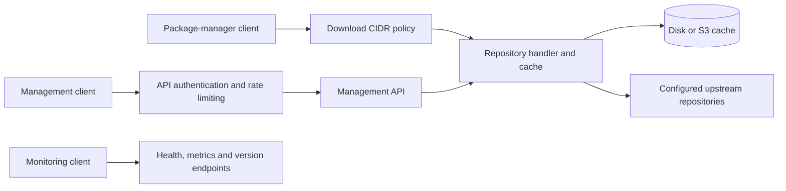

# Architecture and development

[Project README](../README.md) · [中文](development.zh-CN.md)

## Architecture



### Request Flow

1. **Client Request**: A package-manager request passes the configured download CIDR policy before repository handling and cache lookup
2. **Cache Check**: The cache looks for a representation matching the request and repository identity
3. **Cache Hit**: Verify the persistent record and complete body by default, then serve the matching fresh representation
4. **Cache Miss**: Apply the repository route or passthrough policy and fetch from the selected upstream
5. **Deliver & Publish**: Return the response and publish eligible cache data subject to integrity and resource-admission controls

## Project Structure

```text
apt-proxy/
├── cmd/apt-proxy/            # Process entry point
├── internal/
│   ├── access/                 # Download CIDRs and upstream connection policy
│   ├── api/                    # Management endpoints, API keys and rate limiting
│   ├── benchmarks/             # Mirror benchmarking and election
│   ├── cli/                    # Command dispatch, daemon lifecycle and HTTP adapters
│   ├── config/                 # Flags, environment, YAML, defaults and validation
│   ├── distro/                 # Built-in routes and custom distribution registry
│   ├── errors/                 # Structured application errors
│   ├── logsafe/                # Credential-safe log rendering
│   ├── metalink/               # Verified Metalink discovery and snapshot routes
│   ├── mirrorhealth/           # Runtime APT mirror health and failover
│   ├── mirrors/                # Mirror lists, aliases and URL templates
│   ├── passthrough/            # Explicit third-party origin allowlist
│   ├── proxy/                  # Repository routing, upstream transport and downloads
│   ├── repository/             # Verified APT snapshots and offline service
│   ├── resource/               # Shared temporary-copy and download admission budgets
│   ├── sharedcache/            # Repository identities and Unix disk coordination
│   ├── state/                  # Per-server runtime state
│   ├── storage/                # Integrity wrapper and S3 virtual filesystem
│   └── system/                 # Disk and process utilities
├── config/                  # Distribution and mirror examples
├── docs/                    # Feature guides and release notes
├── docker/                  # Source-build and release images
├── examples/                # Deployment and configuration examples
└── tests/                   # Integration and real package-manager clients
```

## Development

### Building from Source

```bash
git clone https://github.com/soulteary/apt-proxy.git
cd apt-proxy
go build -o apt-proxy ./cmd/apt-proxy
```

Use Go **1.27.3**, matching `go.mod` and CI, plus Python 3 and Docker for the
real-client test suite.

When developing alongside [vfs-kit](https://github.com/soulteary/vfs-kit) or [httpcache-kit](https://github.com/soulteary/httpcache-kit), `go.mod` may use `replace` directives (e.g. `../kits/httpcache-kit`); remove them when using published versions.

### Running Tests

```bash
# Run the CI unit suite: race detector, short mode, fresh run
make test

# Generate the CI-style statement coverage profile and enforce the 95% floor
make cover
scripts/check-coverage.sh coverage.out
go tool cover -html=coverage.out

# Run integration-tagged tests (see tests/integration for service prerequisites)
make test-integration
```

The 95% floor applies to total statement coverage across `./...`, not every
package or every branch. Checked-in badges are published snapshots; use the
current run and profile when evaluating changes. See the
[report workflow](../.github/GO-REPORTS.md).

### Contributing

Contributions are welcome! Please feel free to submit a Pull Request.
