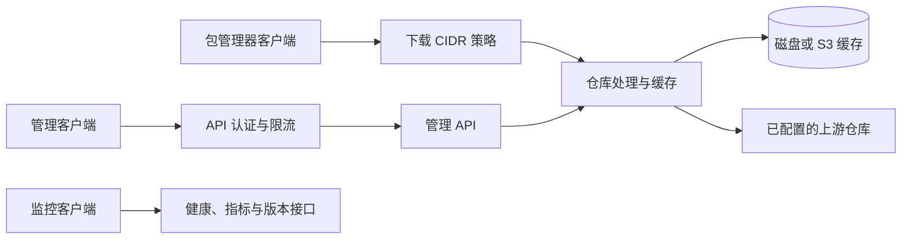

# 架构与开发

[项目首页](../README_CN.md) · [English](development.md)

## 架构



### 请求流程

1. **客户端请求**：包管理器请求先通过配置的下载 CIDR 策略，再进入仓库处理与缓存查找
2. **缓存检查**：查找与请求及仓库身份匹配的缓存表示
3. **缓存命中**：按默认策略校验持久记录与完整响应体，再返回符合请求选择字段和有效期的条目
4. **缓存未命中**：应用仓库路由或 passthrough 策略，从所选上游获取
5. **响应与发布**：返回响应，并按完整性与资源准入策略发布符合条件的缓存数据

## 项目结构

```text
apt-proxy/
├── cmd/apt-proxy/            # 进程入口
├── internal/
│   ├── access/                 # 下载 CIDR 与上游连接策略
│   ├── api/                    # 管理接口、API Key 与限流
│   ├── benchmarks/             # 镜像测速与选优
│   ├── cli/                    # 命令分发、服务生命周期与 HTTP 适配
│   ├── config/                 # 命令行、环境变量、YAML、默认值与校验
│   ├── distro/                 # 内置路由与自定义发行版注册
│   ├── errors/                 # 结构化应用错误
│   ├── logsafe/                # 日志中的凭据脱敏
│   ├── metalink/               # 已验证的 Metalink 发现与快照路由
│   ├── mirrorhealth/           # 运行时 APT 镜像健康与故障切换
│   ├── mirrors/                # 镜像列表、别名与 URL 模板
│   ├── passthrough/            # 显式第三方源站白名单
│   ├── proxy/                  # 仓库路由、上游传输与下载
│   ├── repository/             # 已验证的 APT 快照与离线服务
│   ├── resource/               # 临时副本与下载的共同准入预算
│   ├── sharedcache/            # 仓库身份与 Unix 磁盘协调
│   ├── state/                  # 每个服务实例独立的运行状态
│   ├── storage/                # 完整性封装与 S3 虚拟文件系统
│   └── system/                 # 磁盘与进程工具
├── config/                  # 发行版与镜像配置示例
├── docs/                    # 功能文档与版本说明
├── docker/                  # 源码构建与发布镜像
├── examples/                # 部署与配置示例
└── tests/                   # 集成测试与真实包管理器客户端
```

## 开发

### 从源码构建

```bash
git clone https://github.com/soulteary/apt-proxy.git
cd apt-proxy
go build -o apt-proxy ./cmd/apt-proxy
```

与 [vfs-kit](https://github.com/soulteary/vfs-kit) 或 [httpcache-kit](https://github.com/soulteary/httpcache-kit) 联合开发时，`go.mod` 可使用 `replace` 指向本地目录（如 `../kits/httpcache-kit`）；使用已发布版本时请移除对应 replace。

使用与 `go.mod`、CI 一致的 **Go 1.27.3**。真实客户端测试还需要 Python 3 和 Docker。

### 运行测试

```bash
# 运行与 CI 一致的单元测试：race 检查、short 模式、禁用测试缓存
make test

# 生成与 CI 相同口径的语句覆盖率报告，并检查 95% 门槛
make cover
scripts/check-coverage.sh coverage.out
go tool cover -html=coverage.out

# 运行带 integration 标签的测试，外部服务要求见 tests/integration
make test-integration
```

95% 门槛针对 `./...` 的整体语句覆盖率，不要求每个包或每个分支达到 95%。
仓库中的徽章是已发布的报告快照，评估改动时应以本次运行和 profile 为准，详见
[报告工作流](../.github/GO-REPORTS.md)。

### 贡献代码

欢迎贡献！请随时提交 Pull Request。
