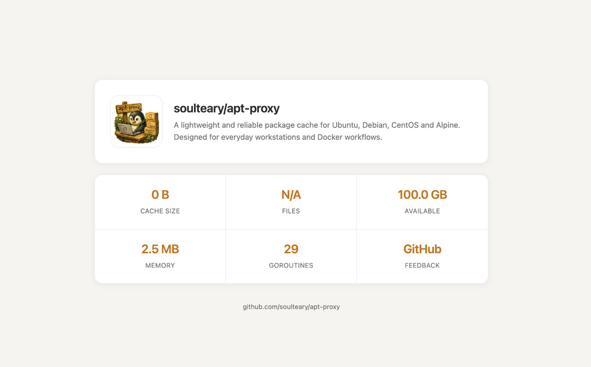

# 运维与管理

[项目首页](../README_CN.md) · [English](operations.md)

## 状态界面

`/` 接口提供状态页面，界面示例：



## API 端点

APT Proxy 提供 REST API 端点用于监控和管理：

### 健康检查与监控

| 端点 | 描述 |
|------|------|
| `GET /healthz` | 综合健康检查（缓存与依赖） |
| `GET /livez` | Kubernetes 存活探针（轻量、不依赖外部组件） |
| `GET /readyz` | Kubernetes 就绪探针（当前与 `/healthz` 共用同一聚合器） |
| `GET /version` | 版本信息（每个响应也会带 `X-Version` 头） |
| `GET /metrics` | Prometheus 指标 |
| `ALL /_/ping`、`ALL /_/ping/*` | 极简可达性探测，固定返回 `pong` |
| `GET /` | 内部状态页面（HTML），展示路由、镜像与缓存统计 |

### 缓存管理（受保护）

| 端点 | 方法 | 描述 |
|------|------|------|
| `/api/cache/stats` | GET | 缓存统计（大小、命中率、条目数） |
| `/api/cache/purge` | POST | 清除所有缓存 |
| `/api/cache/cleanup` | POST | 移除过期缓存条目 |

### 镜像管理（受保护）

| 端点 | 方法 | 描述 |
|------|------|------|
| `/api/mirrors/refresh` | POST | 重载发行版/镜像配置（distributions.yaml）并刷新镜像 |
| `/api/mirrors/status` | GET | 查看进程内的运行时镜像健康状态与选择结果 |

### API 认证

配置 API 密钥并启用认证后，所有 `/api/*` 端点都需要认证。设置 `--api-key`（或 `APT_PROXY_API_KEY`）会隐式启用鉴权，除非显式传入 `--enable-api-auth=false`。如果启用认证但没有配置非空密钥，程序会将其视为无效配置并拒绝启动。

认证关闭时，只读的 `/api/cache/stats` 与 `/api/mirrors/status` 仍可访问；`purge`、`cleanup` 和镜像 `refresh` 等修改类接口默认关闭并返回 HTTP 503，避免未认证的网络监听端口修改代理状态。可通过以下方式提供 API 密钥：

1. **X-API-Key Header**（推荐）：
   ```bash
   curl -H "X-API-Key: your-api-key" http://localhost:3142/api/cache/stats
   ```

2. **Authorization Bearer Token**：
   ```bash
   curl -H "Authorization: Bearer your-api-key" http://localhost:3142/api/cache/stats
   ```

### API 限流

所有 `/api/*` 端点都受**按 IP 限流**保护。默认配额是 **每 IP 每分钟 60 次**（1 分钟滑动窗口）；通过 `--api-rate-limit=0` 可关闭限流。当超出限制时，服务返回 HTTP `429 Too Many Requests`，错误码为 `ErrRateLimited`。

默认情况下客户端 IP 取自 `RemoteAddr`。如部署在 nginx、ALB 或云负载均衡之后，需要解析 `X-Forwarded-For` 时，请用 `--trusted-proxies=10.0.0.0/8,192.168.0.0/16`（或 `APT_PROXY_TRUSTED_PROXIES`）指定**受信任代理 CIDR 列表**。只有来源匹配该列表的请求才会解析 `X-Forwarded-For`，否则忽略以防伪造。

### 响应头

服务在所有响应上自动追加以下头：

- `X-Version`、`X-Build-*` — 版本与构建元信息（也可在 `GET /version` 查询）。
- 标准安全响应头（如 `X-Content-Type-Options`、`X-Frame-Options`、`Referrer-Policy`，启用 TLS 时还有 `Strict-Transport-Security`）。
- 代理响应附带 `X-Cache: HIT`/`MISS`/`SKIP`，用于访问日志按命中类型分类。
- 预算控制的可缓存 GET 可附带 `X-Cache-Staging` HTTP trailer：`ADMITTED` 表示响应暂存准入，`SKIP` 表示暂存被跳过。必须读完整响应体才能看到 trailer；`ADMITTED` 不承诺异步缓存已提交。HEAD、HTTP/1.0 等不支持该 trailer 的情况跳过预算控制的发布。

**示例：获取缓存统计（带认证）**

```bash
curl -H "X-API-Key: your-api-key" http://localhost:3142/api/cache/stats
```

响应：

```json
{
  "total_size_bytes": 1073741824,
  "total_size_human": "1.00 GB",
  "item_count": 150,
  "stale_count": 5,
  "hit_count": 1250,
  "miss_count": 150,
  "hit_rate": 0.893
}
```

## 热重载

APT Proxy 仅支持对**发行版与镜像配置**（含 `distributions.yaml`）热重载，无需重启。**主配置**（如 `apt-proxy.yaml`：服务 host/port、缓存限制、TLS、安全、API Key 等）**不会**热重载，修改后需重启进程。

重载发行版与镜像：

```bash
# 发送 SIGHUP 信号重载配置并刷新镜像
kill -HUP $(pgrep apt-proxy)
```

或启用 API 认证，并使用已配置的密钥调用 API（认证关闭时，修改类接口返回 503）：

```bash
curl -X POST -H "X-API-Key: YOUR_API_KEY" \
  http://localhost:3142/api/mirrors/refresh
```

两种方式效果等价：都会重载 `distributions.yaml` 并重新选择镜像。SIGHUP 信号会被防抖（约 500ms 内的连续信号合并）并排队（重载进行中最多再调度一次），可以放心从脚本批量发送。

重载不会中断服务。镜像重新选举受网络影响、耗时可能较长，在整个窗口期内请求仍由重载前的配置响应；新的发行版及其镜像会在选举完成后**一并**生效，而不是分两步。在此之前，本次重载新增的发行版只是暂不可路由，而不会匹配到一条镜像尚未就绪的规则。

## 可观测性

### 指标

`/metrics` 端点暴露 Prometheus 指标。主要指标与建议告警：

| 指标 / 范围 | 说明 | 建议告警 |
|------------|------|----------|
| `apt_proxy_cache_hits_total` / `apt_proxy_cache_misses_total` | 缓存命中与未命中 | 命中率骤降 |
| `apt_proxy_cache_size_bytes` / `apt_proxy_cache_items` | 当前缓存容量 / 条目数 | 接近 `--cache-max-size` 上限 |
| `apt_proxy_cache_evictions_total` | 因容量限制触发的 LRU 驱逐数 | 持续高频驱逐（缓存过小） |
| `apt_proxy_cache_cleanup_duration_seconds` | 周期清理耗时 | 清理耗时过长 |
| `apt_proxy_cache_upstream_request_duration_seconds{method,status}` | 上游请求耗时（按 method/status） | P99 超阈值 |
| `apt_proxy_cache_upstream_errors_total` | 上游获取错误数 | 错误率突增 |
| 健康检查（`/healthz`、`/readyz`） | 服务与依赖健康 | 探针失败 |

具体的标签集合与额外序列由依赖库 [httpcache-kit](https://github.com/soulteary/httpcache-kit) 暴露；可直接抓取 `/metrics` 查看完整列表。

### 日志

日志为结构化（JSON 或 console），仅通过环境变量配置：

- `APT_PROXY_LOG_LEVEL` — `debug` / `info` / `warn` / `error`（默认 `info`）。`LOG_LEVEL` 作为旧版别名兜底。
- `APT_PROXY_LOG_FORMAT` — `json` / `console` / `auto`（默认 `auto`，stdout 是 TTY 时使用 `console`）。`LOG_FORMAT` 作为旧版别名兜底。
- `--debug` / `APT_PROXY_DEBUG=true` 强制 `debug` 级别，**并**会把请求 header 与 body 打入访问日志，仅排障时使用。

每条请求日志都带有 `request_id`、`cache`（`HIT`/`MISS`/`SKIP`/空）以及响应 `size`。`/healthz`、`/livez`、`/readyz` 这三个探针路径默认从访问日志中跳过，避免噪音。

### 分布式追踪（OpenTelemetry）

设置 `OTEL_EXPORTER_OTLP_ENDPOINT` 指向 OTLP 收集器（如 `http://otel-collector:4317`），即可启用 OpenTelemetry 追踪。导出器会自动接入；优雅退出时 spans 会被 flush。未设置时不启用追踪。
